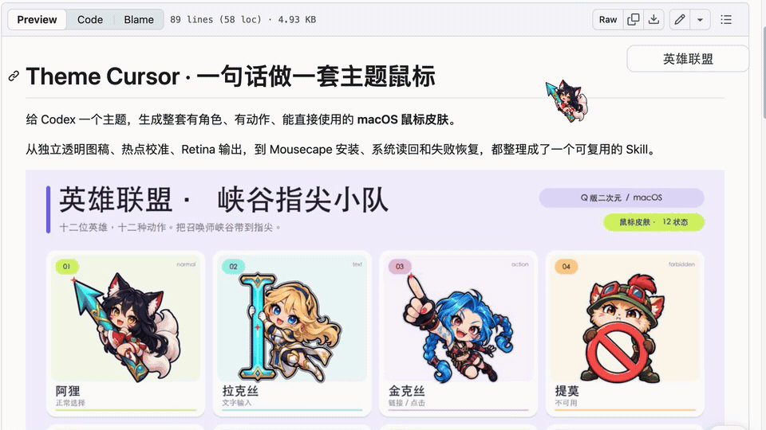
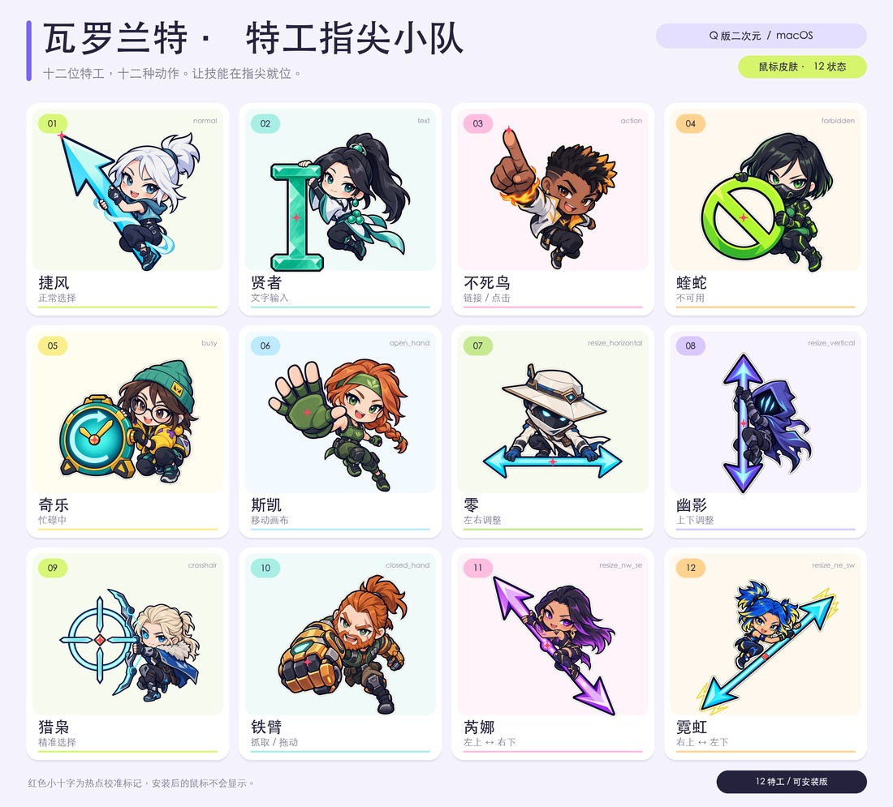

# Theme Cursor · 把游戏角色变成你的鼠标

**四套游戏主题，48 张角色动作图。下载现成皮肤，也可以给 Codex 一个主题，制作自己的鼠标。**

适用于 **macOS + Mousecape**。直接使用成品无需 Codex；AI 自制需要 Codex 的图像生成与本机操作能力。

[下载四套主题](#下载四套主题) · [三步安装](#三步安装) · [制作自己的主题](#用-skill-制作自己的主题) · [完整图鉴](#主题预览) · [常见问题](#常见问题)

## 先看实际效果

[](https://github.com/19012713927zy-beep/theme-cursor/releases/download/v1.1.0/game-cursor-demo.mp4)

**[▶ 观看约 25 秒的 1080p 实际操作演示](https://github.com/19012713927zy-beep/theme-cursor/releases/download/v1.1.0/game-cursor-demo.mp4)**

录制内容是 macOS 系统鼠标在网页上的实际操作，依次展示英雄联盟、瓦罗兰特、三角洲行动与王者荣耀。角色会随普通指针、链接、文本等光标状态切换。

## 下载四套主题

每个安装包包含 `.cape` 主题、完整预览图和中文使用说明。任选一套即可，切换主题不需要重新生成图片。

| 主题 | 这一套有什么 | 下载 |
| --- | --- | --- |
| **英雄联盟 · 峡谷指尖小队** | 阿狸、拉克丝、金克丝等 12 位英雄 | [macOS 安装包](https://github.com/19012713927zy-beep/theme-cursor/releases/download/v1.1.0/league-of-legends-macos.zip) |
| **瓦罗兰特 · 特工指尖小队** | 捷风、贤者、不死鸟等 12 位特工 | [macOS 安装包](https://github.com/19012713927zy-beep/theme-cursor/releases/download/v1.1.0/valorant-macos.zip) |
| **三角洲行动 · 人气皮肤指尖小队** | 蜂医与蝶原皮、威龙「凌霄戍卫」、蛊（女医）等 | [macOS 安装包](https://github.com/19012713927zy-beep/theme-cursor/releases/download/v1.1.0/delta-force-macos.zip) |
| **王者荣耀 · 人气女英雄皮肤小队** | 祈雪灵祝、遇见神鹿、女仆咖啡等 12 款皮肤 | [macOS 安装包](https://github.com/19012713927zy-beep/theme-cursor/releases/download/v1.1.0/honor-of-kings-macos.zip) |

[全部发布附件](https://github.com/19012713927zy-beep/theme-cursor/releases/latest) · [下载制作 Skill](https://github.com/19012713927zy-beep/theme-cursor/releases/download/v1.1.0/theme-cursor-skill-v1.1.0.zip) · [SHA-256 校验值](https://github.com/19012713927zy-beep/theme-cursor/releases/download/v1.1.0/SHA256SUMS.txt)

## 三步安装

1. 从 [Mousecape 官方发布页](https://github.com/sdmj76/Mousecape-swiftUI/releases) 安装适合你 macOS 版本的 Mousecape。
2. 下载上表任意主题并解压，在 Mousecape 中选择 **文件 → 导入 Cape**，打开包内的 `.cape` 文件。
3. 选中导入的主题并点击 **应用**。移动鼠标到链接和文字上，检查角色是否随状态切换。

切换另一套时，导入并应用另一套 `.cape` 即可。恢复时，在 Mousecape 中重新应用原来的主题，或使用恢复默认功能。

## 用 Skill 制作自己的主题

想要别的游戏、动漫角色或自己的 IP，可以使用随项目提供的 Codex Skill。

1. [下载 Skill](https://github.com/19012713927zy-beep/theme-cursor/releases/download/v1.1.0/theme-cursor-skill-v1.1.0.zip)，解压后将 `theme-cursor` 文件夹放入 `~/.codex/skills/`。已有同名文件夹时先备份再替换。
2. 新开 Codex 对话，确认当前会话具备图像生成工具与本机操作能力。
3. 直接说出主题和需求，例如：

```text
用 $theme-cursor 做一套宝可梦主题鼠标，生成后直接部署。
```

也可以先看效果：

```text
用 $theme-cursor 做一套吉卜力森林风格的鼠标，只生成预览，先不安装。
```

同一对话中调用过这个 Skill 后，下一次只需给主题。默认设计 12 种动作；多角色主题分配不同角色，单角色主题设计不同姿势。实际生成工具或本机权限不可用时，需要先补齐对应能力。

## 主题预览

每套包含 12 张独立动作图，覆盖普通指针、文字、链接、禁止、等待、抓取、精准选择和四种缩放方向。**展开下面的主题查看完整图鉴。**

<details>
<summary><strong>英雄联盟 · 峡谷指尖小队 — 展开 12 位英雄</strong></summary>


[下载这套皮肤](https://github.com/19012713927zy-beep/theme-cursor/releases/download/v1.1.0/league-of-legends-macos.zip)

</details>

<details>
<summary><strong>瓦罗兰特 · 特工指尖小队 — 展开 12 位特工</strong></summary>



[下载这套皮肤](https://github.com/19012713927zy-beep/theme-cursor/releases/download/v1.1.0/valorant-macos.zip)

</details>

<details>
<summary><strong>三角洲行动 · 人气皮肤指尖小队 — 展开角色与皮肤</strong></summary>


[下载这套皮肤](https://github.com/19012713927zy-beep/theme-cursor/releases/download/v1.1.0/delta-force-macos.zip)

</details>

<details>
<summary><strong>王者荣耀 · 人气女英雄皮肤小队 — 展开 12 款皮肤</strong></summary>


[下载这套皮肤](https://github.com/19012713927zy-beep/theme-cursor/releases/download/v1.1.0/honor-of-kings-macos.zip)

</details>

## 常见问题

**Windows 可以用吗？** 目前只提供 macOS 的 Mousecape `.cape` 格式，尚未提供 Windows 安装包。

**下载现成皮肤需要 Codex、API Key 或 Python 吗？** 不需要，只需 macOS、Mousecape 和主题安装包。自制主题才需要 Codex 及相应工具能力。

**为什么鼠标上的人物会变化？** 每个角色对应一种光标状态，例如普通指针、链接或文字输入；由当前应用请求的状态决定，不是随机轮换。

**为什么某些软件或游戏里没有变化？** 这些软件可能自己绘制光标，不一定使用系统鼠标图案。

**预览图的红色十字会出现在鼠标上吗？** 不会，它只用于标出点击热点，实际主题中没有这层标记。

**怎么切回去？** 在 Mousecape 中应用原来的主题，或恢复默认。通过 Skill 部署时还会保存恢复快照，具体见 [部署与恢复](skills/theme-cursor/references/runtime.md)。

**导入或应用失败怎么办？** 先确认已解压，并选择包内 `.cape` 文件；核对 Mousecape 与 macOS 版本。仍有问题可 [提交 Issue](https://github.com/19012713927zy-beep/theme-cursor/issues/new)，附主题名称、系统与 Mousecape 版本、报错或截图。

## 技术说明与验证

每套包含 12 张独立角色动作图，输出 32 / 64 / 160 / 320 px 四档尺寸；12 种动作映射到 25 条主题记录，并补充 4 条系统功能记录，共 29 条光标记录。

四套成品均曾在本机 Mousecape 1.2.0 中通过系统读回与界面检查。本次发布重新核对成品与构建记录的哈希、图像密度、热点和透明 Empty，并检查 ZIP 完整性。通用部署脚本在 v1.0.0 发布前通过 8 项回归。尚未验证所有 macOS 版本与注销后重新登录场景。

<details>
<summary><strong>开发者：克隆、依赖与手动构建</strong></summary>

需要 Python 3.10+、Pillow 和 pypdfium2；构建脚本使用已经生成的透明图稿，本身不调用图像生成 API。

```sh
git clone https://github.com/19012713927zy-beep/theme-cursor.git
cd theme-cursor
python3 -m venv .venv
source .venv/bin/activate
python -m pip install -r requirements.txt
python skills/theme-cursor/scripts/cursor_theme.py doctor
```

将 `skills/theme-cursor` 复制到 `~/.codex/skills/` 可安装 Skill；已有同名目录时先备份。

英雄联盟的 [brief.json](examples/league-of-legends/brief.json) 保留了角色、提示词、热点与相对路径。[下载原始图稿与交互预览源码](https://github.com/19012713927zy-beep/theme-cursor/releases/download/v1.0.0/league-of-legends-source.zip) 后，可按 [示例说明](examples/league-of-legends/README.md) 重建成品。

[完整流程](skills/theme-cursor/SKILL.md) · [部署与恢复](skills/theme-cursor/references/runtime.md) · [输入格式](skills/theme-cursor/references/manifest.md) · [角色与动作设计](skills/theme-cursor/references/art-direction.md)

</details>

## 来源与许可

灵感来自 [烤妹儿的演示帖](https://x.com/CrazyKaomei/status/2109523656942760036)，部分预览排版参考 [mouse-pointer-theme-maker](https://github.com/kaomei/mouse-pointer-theme-maker)。代码与文档采用 [MIT](LICENSE)，保留上游署名。

四套游戏主题均为 AI 生成的同人图稿。游戏角色、商标及系统原生素材不属于本项目 MIT 授权范围。详细来源见 [NOTICE.md](NOTICE.md)。
